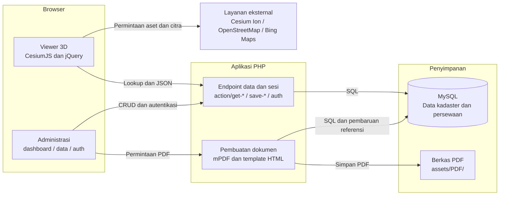

# Arsitektur 3dmap-kadaster

Dokumentasi ini menjelaskan implementasi yang ditinjau pada 21 Oktober 2026. Fokusnya adalah hubungan antara viewer 3D, endpoint PHP, data kadaster, dan pembuatan dokumen PDF.

## Gambaran umum

3dmap-kadaster merupakan aplikasi PHP dengan antarmuka CesiumJS untuk menampilkan objek fisik dan objek legal dalam administrasi pertanahan 3D. Informasi **Rights, Restrictions, Responsibilities (RRR)** menghubungkan ruang atau objek legal dengan hak, batasan, dan tanggung jawab yang terkait.

Viewer mencakup Siola dan Balai Pemuda di Surabaya serta Rusunawa Buring 2 di Malang. Pengguna dapat memilih objek, mencari data, mengatur layer, dan menggunakan alat ukur. Antarmuka administrasi menyediakan pengelolaan data dan permintaan dokumen.

Geometri 3D dan citra peta dimuat langsung oleh browser dari layanan eksternal. Data legal dan persewaan berasal dari MySQL melalui skrip PHP. PDF dibuat di server menggunakan mPDF dan disimpan sebagai berkas.

## Diagram arsitektur



Panah menunjukkan arah permintaan atau operasi; respons tidak digambar. Layanan eksternal dikelompokkan agar diagram tetap ringkas. Tampilan diagram memerlukan pembaca Markdown yang mendukung Mermaid.

## Komponen utama

| Komponen | Tanggung jawab | Sumber implementasi |
| --- | --- | --- |
| Viewer 3D | Menampilkan geometri, mengatur layer dan kamera, memilih objek, mencari data, serta melakukan pengukuran. | [index.php](../index.php), [cesiumScript.js](../assets/js/cesiumScript.js), [cesium-measure-tool.js](../assets/js/cesium-measure-tool.js) |
| Antarmuka administrasi | Mengelola objek legal, ruang, pengelola, penyewa, informasi RRR, dan pengguna; meminta dokumen PDF. | [dashboard/](../dashboard/), [data/](../data/), [auth/login.php](../auth/login.php) |
| Endpoint PHP | Menjalankan pembacaan, pencarian, penyimpanan, penghapusan, dan proses autentikasi. | [action/](../action/), [action/auth/](../action/auth/) |
| MySQL | Menyimpan data kadaster, hubungan persewaan, informasi tertaut, dan akun pengguna. | [database.sql](../database.sql), [db_connect.php](../action/db_connect.php) |
| Pembuat dokumen | Mengisi template HTML dengan data MySQL dan menghasilkan PDF menggunakan mPDF. | [agreement.php](../action/agreement.php), [sertifikatRusun.php](../action/sertifikatRusun.php), [sertifikatSurabayaBuilding.php](../action/sertifikatSurabayaBuilding.php) |
| Penyimpanan dokumen | Menyimpan perjanjian dan sertifikat yang dapat diunduh melalui antarmuka administrasi. | `assets/PDF/agreement/`, `assets/PDF/certificate/` |
| Penyedia peta dan model | Menyediakan tileset 3D melalui Cesium Ion serta citra peta melalui OpenStreetMap dan pilihan Bing Maps. | [cesiumScript.js](../assets/js/cesiumScript.js) |

## Alur utama

### 1. Memuat peta dan model 3D

1. Browser membuka `index.php` dan memuat pustaka antarmuka serta modul `assets/js/cesiumScript.js`.
2. Modul membuat viewer Cesium dan mengatur kontrol layer, kamera, serta minimap OpenLayers.
3. Tileset dimuat dari Cesium Ion menggunakan `Cesium.Cesium3DTileset.fromIonAssetId(...)`.
4. Browser mengakses penyedia citra peta sesuai pilihan basemap.

Jalur pengambilan model tidak melalui endpoint data kadaster PHP. Aset Ion memerlukan token dan akses aset yang sesuai. Inisialisasi `Cesium.Terrain.fromWorldTerrain()` masih dikomentari pada kode yang ditinjau, sehingga world terrain tidak ditampilkan sebagai komponen aktif dalam diagram.

### 2. Memilih objek dan menampilkan informasi legal

1. Pengguna memilih sebuah fitur pada model 3D.
2. Viewer membaca identitas objek dan meminta `action/get-legal-object.php?source=map&objectId=...` melalui AJAX.
3. PHP menggabungkan data objek legal dengan bidang tanah, ruang, hubungan persewaan, penyewa, dan informasi URI tertaut.
4. Endpoint mengembalikan JSON untuk memperbarui panel atau dialog informasi pada viewer.
5. Informasi pengelola dapat diminta secara terpisah melalui `action/get-management.php`.

Identitas fitur 3D dan identitas objek legal menjadi penghubung antara model visual dan data aplikasi.

### 3. Mencari data

Viewer menggunakan [get-search.php](../action/get-search.php) dengan parameter `param` berikut:

| Nilai `param` | Data yang diminta |
| --- | --- |
| `legal` | Objek legal. |
| `room` | Ruang, objek legal, pengelola, dan bidang terkait. |
| `renters` | Hubungan persewaan beserta penyewa, ruang, dan objek legal. |
| `parcel` | Bidang tanah. |

Endpoint mengembalikan JSON yang digunakan oleh antarmuka pencarian. Detail parameter endpoint lain mengikuti implementasi masing-masing skrip PHP.

### 4. Mengelola data dan sesi

Halaman dalam `data/` menggunakan skrip `action/get-*.php` untuk membaca data, `action/save-*.php` untuk menyimpan, dan `action/delete-*.php` untuk menghapus. Sebagian interaksi memakai formulir PHP biasa dan sebagian memakai AJAX.

Proses masuk berada di [process_login.php](../action/auth/process_login.php). Implementasi mencari pengguna berdasarkan email, memeriksa password dengan `password_verify()`, lalu mengisi `$_SESSION['islogin']` ketika pemeriksaan berhasil. Inisialisasi umum berada di [first-load.php](../action/first-load.php).

Keberadaan proses login ini tidak dengan sendirinya menjelaskan cakupan pemeriksaan izin pada setiap endpoint; dokumentasi ini hanya memetakan komponen dan alurnya.

### 5. Menghasilkan perjanjian dan sertifikat

1. Halaman [data/renters/index.php](../data/renters/index.php) mengirim permintaan pembuatan dokumen ke `action/agreement.php`.
2. Handler membuat nomor perjanjian dan memperbarui `renters_tenants.agreement_number`.
3. Handler membaca data penyewa, ruang, pengelola, dan persewaan dari MySQL.
4. Placeholder template HTML diganti dengan data hasil query, lalu mPDF menghasilkan PDF.
5. Berkas perjanjian disimpan di `assets/PDF/agreement/`; berkas sertifikat disimpan di `assets/PDF/certificate/`.
6. Referensi sertifikat disimpan pada `renters_tenants.permit_flats`; antarmuka menyediakan tautan unduh.

Cabang implementasinya berbeda menurut lokasi:

| Lokasi / parameter `from` | Perilaku dalam `agreement.php` |
| --- | --- |
| Siola / `1` dan Balai Pemuda / `2` | Mengisi `generateAgreementSurabayaPDF.html`, kemudian menyimpan hasil mPDF ke direktori perjanjian dan sertifikat. Pemanggilan terpisah ke `sertifikatSurabayaBuilding.php` masih dikomentari pada jalur ini. |
| Rusunawa Buring 2 / `3` | Mengisi `generateAgreementRusunPDF.html` dan `generateAgreementRusunPDF2.html` sebagai dua halaman perjanjian, kemudian memanggil `sertifikatRusun.php` melalui URL aplikasi untuk membuat sertifikat. |

Cabang Rusun bergantung pada konfigurasi base URL yang dapat dijangkau oleh server karena pemanggilan handler sertifikat menggunakan `file_get_contents($urlToRun)`.

## Model data ringkas

Skema fisik tersedia di [database.sql](../database.sql). Tabel berikut dikelompokkan berdasarkan perannya, bukan sebagai ERD lengkap.

| Kelompok | Tabel | Peran |
| --- | --- | --- |
| Kadaster | `land_parcel_table`, `legal_objects_table` | Bidang tanah dan objek legal. |
| Ruang dan pengelola | `rooms_table`, `managements_table` | Ruang beserta pengelolanya. |
| Penyewa dan persewaan | `tenants_table`, `renters_tenants` | Identitas penyewa dan hubungannya dengan ruang, termasuk masa berlaku serta referensi dokumen. |
| Informasi tertaut | `uri_table`, `linked_uri` | Informasi URI/kata kunci yang ditautkan ke objek legal, termasuk informasi terkait RRR. |
| Pengguna dan masukan | `users`, `critics` | Akun pengguna dan masukan pengguna. |

Relasi foreign key yang dinyatakan dalam skema meliputi:

- `rooms_table.legal_object_id` ke `legal_objects_table.id`.
- `rooms_table.organizer_id` ke `managements_table.id`.
- `renters_tenants.room_id` ke `rooms_table.room_id`.
- `renters_tenants.tenant_id` ke `tenants_table.id`.
- `linked_uri.object_id` ke `legal_objects_table.id`.
- `linked_uri.id_keyword` ke `uri_table.id_keyword`.

Query aplikasi juga menghubungkan `legal_objects_table.parcel_id` dengan `land_parcel_table.parcel_id`. Hubungan melalui query ini dibedakan dari foreign key yang dideklarasikan dalam berkas SQL.

## Struktur direktori

```text
3dmap-kadaster/
├── index.php                 # Halaman utama viewer
├── action/                   # Handler data, autentikasi, dan PDF
│   └── auth/                 # Proses masuk, daftar, dan keluar
├── assets/
│   ├── css/                  # Gaya antarmuka
│   ├── js/                   # Viewer, interaksi UI, dan alat ukur
│   ├── view/                 # Bagian tampilan bersama
│   └── PDF/                  # Perjanjian dan sertifikat hasil generasi
├── auth/                     # Antarmuka masuk
├── dashboard/                # Halaman administrasi
├── data/                     # Antarmuka pengelolaan data
├── docs/                     # Dokumentasi proyek
├── vendor/                   # Dependensi Composer
├── composer.json             # Definisi dependensi PHP
├── database.sql              # Skema dan data SQL yang disertakan
└── generate*.html            # Template dokumen PDF
```

## Konfigurasi yang terkait dengan arsitektur

| Bagian | Lokasi | Pengaruh |
| --- | --- | --- |
| Koneksi MySQL | `action/db_connect.php` | Digunakan oleh handler yang membaca dan mengubah data. |
| Base URL, sesi, dan zona waktu | `action/first-load.php` | Menyediakan inisialisasi umum; base URL dipakai untuk pemanggilan internal pada alur dokumen Rusun. |
| Token Ion dan identitas aset | `assets/js/cesiumScript.js` | Menentukan akses dan tileset yang dimuat ke viewer. |
| Dependensi PHP | `composer.json` | Memuat mPDF, HTMLPurifier, dan slug generator; penggunaan setiap pustaka mengikuti handler terkait. |
| Direktori hasil PDF | `assets/PDF/agreement/`, `assets/PDF/certificate/` | Harus tersedia dan dapat ditulis oleh proses PHP agar pembuatan dokumen berhasil. |
| Document root web server | Root proyek | Banyak include dan URL aplikasi menggunakan `$_SERVER['DOCUMENT_ROOT']` atau path absolut dari root web. |

Panduan menjalankan aplikasi tersedia di [README proyek](../README.md#how-to-use).

## Batas cakupan

Dokumentasi disusun dari pembacaan kode sumber, bukan dari pengujian runtime, pengujian akses aset Ion, atau audit keamanan. Diagram merangkum tujuh komponen dan tujuh operasi utama.

Handler individual, seluruh relasi tabel, mekanisme autentikasi terperinci, CDN pustaka, unggahan, model lokal tambahan, dan fitur masukan pengguna tidak digambar terpisah. Skrip salinan seperti `cesiumScript copy.js` bukan sumber utama diagram; halaman utama memuat `assets/js/cesiumScript.js`.

Tampilan warna atau tipografi diagram Mermaid mengikuti pembaca Markdown yang digunakan. Struktur komponen dan alurnya mengikuti overview arsitektur proyek.
